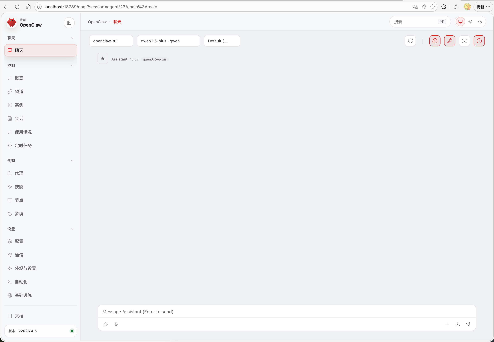

# 介绍

OpenClaw 是一个开源的自主人工智能（AI）代理平台，由软件工程师 Peter Steinberger 于2025年底发布。与依赖云端服务器的传统 AI 助手不同，它专为在用户本地设备或私有服务器上运行而设计，并通过即时通讯软件提供前端交互界面。该平台的能力远不止文本生成，还支持 AI 智能体加载模块化技能，调用外部工具、对接各类 API，进而自动执行完整任务流程。

该平台的底层架构强调数据隔离和模型中立性，系统配置主要通过 Markdown 或 YAML 文件完成，并支持用户根据需求自主接入不同的大语言模型。2026 年初，OpenClaw 的创始人加入 OpenAI 参与智能代理技术的研发，而 OpenClaw 项目本身则转型为基金会支持的开源项目，继续由开发者社区维护和使用。

# 实验环境

本次部署的基础环境如下：

 - 硬件设备：RaspberryPi 5

 - 操作系统：openEuler 24.03 LTS


# 部署

## 安装依赖

首先，需要安装 `tar` 和 `git` 软件包以满足后续环境的构建需求：

```
sudo dnf install tar git
```

## 添加 OpenClaw 用户

添加 OpenClaw 用户并设置 sudo 权限：

```
useradd -m -s /bin/bash openclaw
echo "openclaw ALL=(ALL) NOPASSWD: ALL" >> /etc/sudoers
```

切换到 openclaw 用户：

```
su - openclaw
```

## 安装 Node.js

OpenClaw 的运行底层依赖于 Node.js，且要求版本必须大于 22。此处通过 nvm（Node Version Manager）进行快速安装：

```
curl -o- https://raw.githubusercontent.com/nvm-sh/nvm/v0.40.4/install.sh | bash

source .bashrc

nvm install 22
nvm use 22
nvm alias default 22

# 验证 Node.js 版本：
node -v # Should print "v22.22.2".

# 验证 npm 版本：
npm -v # Should print "10.9.7".
```

## 安装 OpenClaw

执行官方脚本下载并安装 OpenClaw 核心程序：

```
curl -fsSL https://openclaw.bot/install.sh | bash
```

当显示以下信息时，表示 openclaw 已经安装完成，接下来进行配置：

```
🦞 OpenClaw installed successfully (OpenClaw 2026.4.5 (3e72c03))!
Finally unpacked. Now point me at your problems.

· Starting setup


🦞 OpenClaw 2026.4.5 (3e72c03) — Say "stop" and I'll stop—say "ship" and we'll both learn a lesson.

▄▄▄▄▄▄▄▄▄▄▄▄▄▄▄▄▄▄▄▄▄▄▄▄▄▄▄▄▄▄▄▄▄▄▄▄▄▄▄▄▄▄▄▄▄▄▄▄▄▄▄▄
██░▄▄▄░██░▄▄░██░▄▄▄██░▀██░██░▄▄▀██░████░▄▄▀██░███░██
██░███░██░▀▀░██░▄▄▄██░█░█░██░█████░████░▀▀░██░█░█░██
██░▀▀▀░██░█████░▀▀▀██░██▄░██░▀▀▄██░▀▀░█░██░██▄▀▄▀▄██
▀▀▀▀▀▀▀▀▀▀▀▀▀▀▀▀▀▀▀▀▀▀▀▀▀▀▀▀▀▀▀▀▀▀▀▀▀▀▀▀▀▀▀▀▀▀▀▀▀▀▀▀
                  🦞 OPENCLAW 🦞                    
 
┌  OpenClaw setup
```

选择 Yes 然后按 Enter 进行确认：

```
◆  I understand this is personal-by-default and shared/multi-user use requires lock-down. Continue?
│  ● Yes / ○ No
```

这里选择 QuickStart：

```
◆  Setup mode
│  ● QuickStart (Configure details later via openclaw configure.)
│  ○ Manual
```

根据实际情况选择使用的模型，这里选择的是 Qwen Cloud：

```
◆  Model/auth provider
│  ○ Anthropic
│  ○ BytePlus
│  ○ Chutes
│  ○ Cloudflare AI Gateway
│  ○ Copilot Proxy
│  ○ Custom Provider
│  ○ DeepSeek
│  ○ Fireworks
│  ○ Gemini CLI OAuth
│  ○ GitHub Copilot
│  ○ Google
│  ○ Hugging Face
│  ○ Kilo Gateway
│  ○ LiteLLM
│  ○ Microsoft Foundry
│  ○ MiniMax
│  ○ Mistral AI
│  ○ Moonshot AI (Kimi K2.5)
│  ○ Ollama
│  ○ OpenAI
│  ○ OpenAI Codex
│  ○ OpenCode
│  ○ OpenRouter
│  ○ Qianfan
│  ● Qwen Cloud (Standard / Coding Plan (CN / Global) + multimodal roadmap)
│  ○ SGLang
│  ○ StepFun
│  ○ Synthetic
│  ○ Together AI
│  ○ Venice AI
│  ○ Vercel AI Gateway
│  ○ vLLM
│  ○ Volcano Engine
│  ○ xAI (Grok)
│  ○ Xiaomi
│  ...
```

根据实际情况选择验证方式，这里使用的 Qwen Cloud API 获取网址为：https://home.qwencloud.com/api-keys

```
◇  Model/auth provider
│  Qwen Cloud
│
◇  Qwen Cloud auth method
│  Standard API Key for China (pay-as-you-go)
│
◇  Qwen Cloud Standard (China) ────────────────────────────────╮
│                                                              │
│  Manage API keys: https://home.qwencloud.com/api-keys        │
│  Docs: https://docs.qwencloud.com/                           │
│  Endpoint: dashscope.aliyuncs.com/compatible-mode/v1         │
│  Models: qwen3.6-plus, qwen3.5-plus, qwen3-coder-plus, etc.  │
│                                                              │
├──────────────────────────────────────────────────────────────╯
│
◇  Enter Qwen Cloud API key (China standard endpoint)
│  sk-xxxxxxxxxxxxxxxx
│
◇  Model configured ───────────────────────╮
│                                          │
│  Default model set to qwen/qwen3.5-plus  │
│                                          │
├──────────────────────────────────────────╯
```

根据实际情况选择需要使用的模型：

```
◆  Default model
│  ● Keep current (qwen/qwen3.5-plus)
│  ○ Enter model manually
│  ○ qwen/glm-4.7
│  ○ qwen/glm-5
│  ○ qwen/kimi-k2.5
│  ○ qwen/MiniMax-M2.5
│  ○ qwen/qwen3-coder-next
│  ○ qwen/qwen3-coder-plus
│  ○ qwen/qwen3-max-2026-01-23
│  ○ qwen/qwen3.5-plus
│  ○ qwen/qwen3.6-plus
```

频道选择，国内用户可以选择“直接跳过”，或者根据实际情况配置为其他：

```
◆  Select channel (QuickStart)
│  ○ Feishu/Lark (飞书)
│  ○ Google Chat (Chat API)
│  ○ Nostr
│  ○ Microsoft Teams (Bot Framework)
│  ○ Mattermost (plugin)
│  ○ Nextcloud Talk (self-hosted)
│  ○ Matrix (plugin)
│  ○ BlueBubbles (macOS app)
│  ○ LINE (Messaging API)
│  ○ Zalo (Bot API)
│  ○ Zalo (Personal Account)
│  ○ Synology Chat (Webhook)
│  ○ Tlon (Urbit)
│  ○ Discord (Bot API)
│  ○ iMessage (imsg)
│  ○ IRC (Server + Nick)
│  ○ QQ Bot
│  ○ Signal (signal-cli)
│  ○ Slack
│  ○ Telegram (Bot API)
│  ○ Twitch (Chat)
│  ○ WhatsApp (QR link)
│  ● Skip for now (You can add channels later via `openclaw channels add`)
```

根据实际情况选择需要使用的网页搜索提供商，这里使用的是 Kimi，API 获取地址为：https://platform.moonshot.cn/console/api-keys

```
◇  Web search ─────────────────────────────────────────────────────────────────╮
│                                                                              │
│  Web search lets your agent look things up online.                           │
│  Choose a provider. Some providers need an API key, and some work key-free.  │
│  Docs: https://docs.openclaw.ai/tools/web                                    │
│                                                                              │
├──────────────────────────────────────────────────────────────────────────────╯
│
◇  Search provider
│  Kimi (Moonshot)
│
◇  Moonshot / Kimi API key
│  sk-xxxxxxxxxxxxxx
│
◇  Kimi API region
│  Moonshot API key (.cn)
│
◇  Kimi web search model
│  Use default (moonshot/kimi-k2.5)
│
◇  Skills status ─────────────╮
│                             │
│  Eligible: 4                │
│  Missing requirements: 39   │
│  Unsupported on this OS: 7  │
│  Blocked by allowlist: 0    │
│                             │
├─────────────────────────────╯
│
```

可以按需选择，或者直接跳过，后续对话过程也可以安装：

```
◇  Configure skills now? (recommended)
│  No
│
◇  Set GOOGLE_PLACES_API_KEY for goplaces?
│  No
│
◇  Set NOTION_API_KEY for notion?
│  No
│
◇  Set OPENAI_API_KEY for openai-whisper-api?
│  No
│
◇  Set ELEVENLABS_API_KEY for sag?
│  No
```

Hooks 安装，根据实际情况选择，这里选择了 “session-memory” 是保存会话相关的状态或记忆，让它下次能延续上下文，体验会更连贯：

```
◆  Enable hooks?
│  ◻ Skip for now
│  ◻ 🚀 boot-md
│  ◻ 📎 bootstrap-extra-files
│  ◻ 📝 command-logger
│  ◼ 💾 session-memory (Save session context to memory when /new or /reset command is issued)
```

出现以下提示时，表示 OpenClaw 已经成功安装：

```
└  Onboarding complete. Use the dashboard link above to control OpenClaw.
```

## 启动 openclaw

运行以下命令来启动 OpenClaw：

```
openclaw gateway --verbose
```

启动后查看 OpenClaw 运行状态：

```
# 查看clawbot是否在后台运行
openclaw health
# 查看模型状态
openclaw models list
```

使用 `openclaw dashboard` 来查看面板地址：

```
🦞 OpenClaw 2026.4.5 (3e72c03) — I don't just autocomplete—I auto-commit (emotionally), then ask you to review (logically).

Dashboard URL: http://127.0.0.1:18789/#token=5e0c033fd902120d172473ffd5e57d4860f1845eb7a7c863
Copy to clipboard unavailable.
No GUI detected. Open from your computer:
ssh -N -L 18789:127.0.0.1:18789 root@192.168.6.221
Then open:
http://localhost:18789/
http://localhost:18789/#token=5e0c033fd902120d172473ffd5e57d4860f1845eb7a7c863
Docs:
https://docs.openclaw.ai/gateway/remote
https://docs.openclaw.ai/web/control-ui
```

OpenClaw 只能通过 locahost 方式访问，在本机运行以下命令，IP 地址需要换成树莓派的实际 IP：

```
ssh -N -L 18789:127.0.0.1:18789 root@192.168.6.221
```

然后使用浏览器打开：http://127.0.0.1:18789/#token=5e0c033fd902120d172473ffd5e57d4860f1845eb7a7c863

注意，面板地址需要换成实际显示的地址，浏览器打开如下图即可使用：

