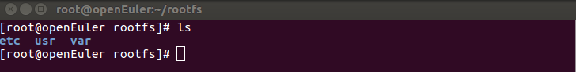
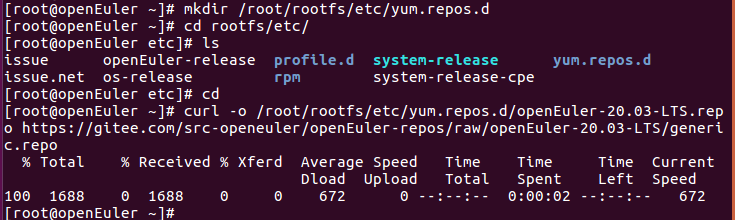

- [描述](#描述)
- [准备编译环境](#准备编译环境)
- [编译 U-Boot 启动文件](#编译-u-boot-启动文件)
  - [编译 RK3399 U-Boot](#编译-rk3399-u-boot)
  - [编译 RK356x/RK3588 U-Boot](#编译-rk356xrk3588-u-boot)
  - [编译 H616/H618 U-Boot](#编译-h616h618-u-boot)
  - [编译 A311D U-Boot](#编译-a311d-u-boot)
  - [关于 PhytiumPi U-Boot](#关于-phytiumpi-u-boot)
- [基于 openEuler 内核编译内核镜像](#基于-openeuler-内核编译内核镜像)
  - [编译内核代码](#编译内核代码)
- [构建 boot 镜像](#构建-boot-镜像)
- [构建 rootfs 镜像](#构建-rootfs-镜像)
  - [创建 RPM 数据库](#创建-rpm-数据库)
  - [下载安装 openEuler 发布包](#下载安装-openeuler-发布包)
  - [添加 yum 源](#添加-yum-源)
  - [安装 dnf](#安装-dnf)
  - [安装必要软件](#安装必要软件)
  - [添加配置文件](#添加配置文件)
  - [rootfs 设置](#rootfs-设置)
- [制作 openEuler 镜像](#制作-openeuler-镜像)
  - [创建镜像](#创建镜像)
    - [创建空镜像](#创建空镜像)
    - [镜像分区](#镜像分区)
      - [创建分区表](#创建分区表)
      - [镜像分区](#镜像分区-1)
      - [设置 boot 分区为可启动](#设置-boot-分区为可启动)
  - [使用 losetup 将磁盘镜像文件虚拟成块设备](#使用-losetup-将磁盘镜像文件虚拟成块设备)
  - [使用 kpartx 创建分区表 /dev/loop0 的设备映射](#使用-kpartx-创建分区表-devloop0-的设备映射)
  - [写入 U-Boot](#写入-u-boot)
  - [格式化分区](#格式化分区)
  - [创建要挂载的根目录和 boot 分区路径](#创建要挂载的根目录和-boot-分区路径)
  - [挂载根目录和 boot 分区](#挂载根目录和-boot-分区)
  - [获取生成的 img 镜像的 blkid](#获取生成的-img-镜像的-blkid)
  - [修改 fstab](#修改-fstab)
  - [rootfs 拷贝到镜像](#rootfs-拷贝到镜像)
  - [boot 引导拷贝到镜像](#boot-引导拷贝到镜像)
  - [卸载镜像](#卸载镜像)
    - [同步到盘](#同步到盘)
    - [卸载](#卸载)
    - [卸载镜像文件虚拟的块设备](#卸载镜像文件虚拟的块设备)

# 描述

本文档介绍如何构建适用于 Rockchip、Allwinner 以及 Phytium 开发板的 openEuler 镜像。

# 准备编译环境

1.  系统要求
    - 操作系统：openEuler
    - 架构：AArch64

2.  安装依赖包

    ```
    dnf makecache
    dnf install git wget make gcc bison dtc m4 flex bc openssl-devel tar dosfstools rsync parted dnf-plugins-core tar
    ```

3.  创建工作目录
    ```
    WORKDIR=$(pwd)/build
    mkdir $WORKDIR
    cd $WORKDIR
    ```

# 编译 U-Boot 启动文件

## 编译 RK3399 U-Boot

1. 下载源码

    ```
    cd $WORKDIR
    git clone --branch v2020.10 https://github.com/u-boot/u-boot.git
    ```

2. 获取 ARM-Trusted-Firmware

    ```
    cd u-boot
    wget -O bl31.elf https://github.com/rockchip-linux/rkbin/raw/master/bin/rk33/rk3399_bl31_v1.35.elf
    ```

3. 编译 U-Boot

    ```
    make ARCH=arm firefly-rk3399_defconfig
    make ARCH=arm -j$(nproc)
    make ARCH=arm u-boot.itb -j$(nproc)
    ```

4.  收集编译结果

    将生成的 idbloader.img 和 u-boot.itb 文件复制到工作目录。

    ```
    cp idbloader.img $WORKDIR
    cp idbloader.img $WORKDIR
    cd $WORKDIR
    ```

## 编译 RK356x/RK3588 U-Boot

1. 下载源码

    - RK3566/RK3568 开发板：以 `Firefly ROC-RK3566-PC` 和 `Firefly ROC-RK3568-PC-SE` 为例，下载其官方提供的 U-Boot 源码：

        ```
        cd $WORKDIR
        git clone --branch rk356x/firefly-5.10 --depth=1 https://gitlab.com/firefly-linux/u-boot.git
        ```

    - RK3588 开发板：以 `Firefly ROC-RK3588S-PC` 为例，下载其官方提供的 U-Boot 源码：

        ```
        cd $WORKDIR
        git clone --branch rk3588/firefly --depth=1 https://gitlab.com/firefly-linux/u-boot.git
        ```

2. 下载 rkbin

    ```
    cd $WORKDIR
    git clone --depth=1 https://github.com/rockchip-linux/u-boot.git -o 7c35e21a8529b3758d1f051d1a5dc62aae934b2b --recursive --depth=1
    ```

3. 编译 U-Boot

    - RK3566/RK3568 开发板：以 `Firefly ROC-RK3566-PC` 和 `Firefly ROC-RK3568-PC-SE` 为例，使用其官方的 U-Boot 源码进行编译：

        ```
        make ARCH=arm rk3568_defconfig
        make ARCH=arm -j$(nproc)
        ```

        注意：这里 Firefly 的 U-Boot 源码中的 `rk3568_defconfig` U-Boot 配置文件中指定的 `rk3568-evb.dts` 仅保证可用于 Firefly 的 RK3566/RK3568 设备：

        https://gitlab.com/firefly-linux/u-boot/-/blob/rk356x/firefly-5.10/configs/rk3568_defconfig?ref_type=heads#L21

    - RK3588 开发板：以 `Firefly ROC-RK3588S-PC` 为例，使用其官方的 U-Boot 源码进行编译：

        ```
        make ARCH=arm rk3588_defconfig
        make ARCH=arm -j$(nproc)
        ```

        注意：这里 Firefly 的 U-Boot 源码中的 `rk3588_defconfig` U-Boot 配置文件中指定的 `rk3588-evb.dts` 仅保证可用于 Firefly 的 RK3588 设备：

        https://gitlab.com/firefly-linux/u-boot/-/blob/rk3588/firefly/configs/rk3588_defconfig?ref_type=heads#L23

4.  生成 idbloader.img

    - RK3566

        ```
        tools/mkimage -n rk356x -T rksd -d ../rkbin/bin/rk35/rk3566_ddr_1056MHz_v1.23.bin:spl/u-boot-spl.bin idbloader.img
        ```

    - RK3568

        ```
        tools/mkimage -n rk356x -T rksd -d ../rkbin/bin/rk35/rk3568_ddr_1560MHz_v1.23.bin:spl/u-boot-spl.bin idbloader.img
        ```

    - RK3588

        ```
        tools/mkimage -n rk3588 -T rksd -d ../rkbin/bin/rk35/rk3588_ddr_lp4_2112MHz_lp5_2400MHz_v1.18.bin:spl/u-boot-spl.bin idbloader.img
        ```

    输出如下：

    ```
    Image Type:   Rockchip RK35 boot image
    Init Data Size: 75776 bytes
    Boot Data Size: 256000 bytes
    ```

5.  生成 u-boot.itb

    - RK3566/RK3568

        ```
        cp ../rkbin/bin/rk35/rk3568_bl31_v1.44.elf bl31.elf
        arch/arm/mach-rockchip/make_fit_atf.sh u-boot.dtb > uboot.its

        cp ../rkbin/bin/rk35/rk3568_bl32_v2.14.bin tee.bin
        tools/mkimage -f uboot.its -E u-boot.itb
        ```

    - RK3588

        ```
        cp ../rkbin/bin/rk35/rk3588_bl31_v1.47.elf bl31.elf
        arch/arm/mach-rockchip/make_fit_atf.sh u-boot.dtb > uboot.its

        cp ../rkbin/bin/rk35/rk3588_bl32_v1.17.bin tee.bin
        tools/mkimage -f uboot.its -E u-boot.itb
        ```

        输出如下：

        ```
        FIT description: FIT Image with ATF/OP-TEE/U-Boot/MCU
        Created:         Fri Nov  8 09:14:41 2024
         Image 0 (uboot)
          Description:  U-Boot
          Created:      Fri Nov  8 09:14:41 2024
          Type:         Standalone Program
          Compression:  uncompressed
          Data Size:    1357176 Bytes = 1325.37 KiB = 1.29 MiB
          Architecture: AArch64
          Load Address: 0x00200000
          Entry Point:  unavailable
          Hash algo:    sha256
          Hash value:   67813f7c0d6c6f429254565954b83d91fd00fdd36735c18833b2f892a74d7a2f
         Image 1 (atf-1)
          Description:  ARM Trusted Firmware
          Created:      Fri Nov  8 09:14:41 2024
          Type:         Firmware
          Compression:  uncompressed
          Data Size:    204860 Bytes = 200.06 KiB = 0.20 MiB
          Architecture: AArch64
          Load Address: 0x00040000
          Hash algo:    sha256
          Hash value:   6a4a192c104cc98c4b7e63ad0c6728b27b1af0a95fb9555b19faf55f8cf5871c
         Image 2 (atf-2)
          Description:  ARM Trusted Firmware
          Created:      Fri Nov  8 09:14:41 2024
          Type:         Firmware
          Compression:  uncompressed
          Data Size:    36864 Bytes = 36.00 KiB = 0.04 MiB
          Architecture: AArch64
          Load Address: 0xff100000
          Hash algo:    sha256
          Hash value:   70505bb764db81a665c8bba4953d804ed9eab580d5428888a4436121eff11c50
         Image 3 (atf-3)
          Description:  ARM Trusted Firmware
          Created:      Fri Nov  8 09:14:41 2024
          Type:         Firmware
          Compression:  uncompressed
          Data Size:    24576 Bytes = 24.00 KiB = 0.02 MiB
          Architecture: AArch64
          Load Address: 0x000f0000
          Hash algo:    sha256
          Hash value:   569ee96047e8ff069a6f89d1f62a530133c3e0afc74da4958519da2b51ec57d6
         Image 4 (optee)
          Description:  OP-TEE
          Created:      Fri Nov  8 09:14:41 2024
          Type:         Firmware
          Compression:  uncompressed
         Data Size:    465312 Bytes = 454.41 KiB = 0.44 MiB
          Architecture: AArch64
          Load Address: 0x08400000
          Hash algo:    sha256
          Hash value:   66e4b7a4cd05b86d45085ccc6f676d596c581d7e5c981c916c874abd0ebfad54
         Image 5 (fdt)
         Description:  U-Boot dtb
          Created:      Fri Nov  8 09:14:41 2024
          Type:         Flat Device Tree
          Compression:  uncompressed
          Data Size:    8867 Bytes = 8.66 KiB = 0.01 MiB
          Architecture: AArch64
          Hash algo:    sha256
          Hash value:   a434b1c4fe1fe989156b3b53572daa76e0342fbcf2503fd4807ad30f8da2ce71
         Default Configuration: 'conf'
         Configuration 0 (conf)
          Description:  rk3588-evb
          Kernel:       unavailable
          Firmware:     atf-1
          FDT:          fdt
          Loadables:    uboot
                        atf-2
                        atf-3
                        optee
        ```

6.  收集编译结果

    将生成的 idbloader.img 和 u-boot.itb 文件复制到工作目录。

    ```
    cp idbloader.img $WORKDIR
    cp idbloader.img $WORKDIR
    cd $WORKDIR
    ```

## 编译 H616/H618 U-Boot

1. 下载源码

    1. 下载 Arm Trusted Firmware 源码

        ```
        git clone --depth=1 https://github.com/ARM-software/arm-trusted-firmware.git -b lts-v2.10.26
        ```

    2. 下载 U-Boot 源码

        U-Boot 版本参考 [Sipeed 官方构建仓库使用的版本](https://github.com/sipeed/LonganPi-3H-SDK/blob/main/mkuboot.sh#L26C2-L26C55)

        ```
        git clone https://github.com/u-boot/u-boot.git
        git checkout da2e3196e4dc28298b58a018ace07f85eecd1652
        ```

2. 下载并应用 U-Boot 补丁

    对于 LonganPi 3H，U-Boot 需要打补丁才能正常工作，OrangePi Zero 2 则不需要。
   
    从以下位置下载补丁：

    https://github.com/sipeed/LonganPi-3H-SDK/tree/main/uboot

    将补丁放在与 `u-boot` 以及 `arm-trusted-firmware` 同一级的文件夹 `u-boot-patch` 文件夹中，使用以下命令来应用补丁：

    ```
    cd u-boot
    find ../u-boot-patch/ -name *.patch | sort | while read line
	do
		git am < $line
	done
    ```

3. 编译 Arm Trusted Firmware

    ```
    cd ..
    cd arm-trusted-firmware

    make PLAT=sun50i_h616 bl31
    cp build/sun50i_h616/release/bl31.bin ../
    ```

    此处的参数 `PLAT=sun50i_h616` 指定平台为 `H616` 以及 `H618`。

4. 编译 U-Boot

    1. 应用 U-boot 配置

        - LonganPi 3H

            ```
            make ARCH=arm64 longanpi_3h_defconfig
            ```

        - OrangePi Zero 2

            ```
            make ARCH=arm64 orangepi_zero2_defconfig
            ```

    2. 编译 u-boot-sunxi-with-spl.bin

        ```
        export BL31=$(pwd)/../bl31.bin
        make ARCH=arm64 -j$(nproc)
        ```

5.  收集编译结果

    将生成的 idbloader.img 和 u-boot.itb 文件复制到工作目录。

    ```
    cp u-boot-sunxi-with-spl.bin $WORKDIR
    cd $WORKDIR
    ```

## 编译 A311D U-Boot

1.  下载源码

    1. 下载 U-Boot 源码

        ```
        git clone --depth=1 https://github.com/u-boot/u-boot.git -b v2025.10
        ```

    2. 下载 U-Boot 打包工具

        ```
        git clone --depth=1 https://github.com/LibreELEC/amlogic-boot-fip.git
        ```

2.  编译 U-Boot

    1.  配置 U-Boot

        ```
        cd u-boot
        make ARCH=arm khadas-vim3_defconfig
        ```

        如果需要自定义 U-Boot 功能

        ```
        make ARCH=arm menuconfig
        ```

    2.  编译 U-Boot

        ```
        make ARCH=arm -j$(nproc)
        ```

3.  运行 U-Boot 打包脚本

    如果是 `aarch64` 架构的构建主机，运行之前需要安装 `qemu-user` 软件包：
    
    - Debian/Ubuntu 安装命令如下；

        ```
        sudo apt-get install qemu-user
        ```

    - openEuler 25.09 安装命令如下：

        ```
        sudo dnf install qemu-user
        ```

    - 其他 openEuler 版本安装命令如下：

        ```
        wget https://repo.openeuler.openatom.cn/openEuler-25.09/everything/aarch64/Packages/qemu-user-8.2.0-47.oe2509.aarch64.rpm
        wget https://repo.openeuler.openatom.cn/openEuler-25.09/everything/aarch64/Packages/qemu-user-binfmt-8.2.0-47.oe2509.aarch64.rpm
        rpm -ivh qemu-user-8.2.0-47.oe2509.aarch64.rpm
        rpm -ivh qemu-user-binfmt-8.2.0-47.oe2509.aarch64.rpm
        ```

    U-Boot 编译完成后，运行以下命令来打包 U-Boot

    ```
    cd ../amlogic-boot-fip
    mkdir ../output

    ./build-fip.sh khadas-vim3 ../u-boot/u-boot.bin ../output
    ```

    运行以上命令后，输出如下：

    ```
    make: Entering directory '/home/chainsx/amlogic-boot-fip/khadas-vim3'
    ./blx_fix.sh bl2.bin /tmp/tmp.pHimpYgceC/zero_tmp /tmp/tmp.pHimpYgceC/bl2_zero.bin acs.bin /tmp/tmp.pHimpYgceC/bl21_zero.bin /tmp/tmp.pHimpYgceC/bl2_new.bin bl2
    4224+0 records in
    4224+0 records out
    4224 bytes (4.2 kB, 4.1 KiB) copied, 0.003218 s, 1.3 MB/s
    2384+0 records in
    2384+0 records out
    2384 bytes (2.4 kB, 2.3 KiB) copied, 0.00177716 s, 1.3 MB/s
    qemu-x86_64 -L /usr/x86_64-linux-gnu/ ./aml_encrypt_g12b --bl2sig --input /tmp/tmp.pHimpYgceC/bl2_new.bin --output /tmp/tmp.pHimpYgceC/bl2.n.bin.sig
    ./blx_fix.sh bl30.bin /tmp/tmp.pHimpYgceC/zero_tmp /tmp/tmp.pHimpYgceC/bl30_zero.bin bl301.bin /tmp/tmp.pHimpYgceC/bl301_zero.bin /tmp/tmp.pHimpYgceC/bl30_new.bin bl30
    48+0 records in
    48+0 records out
    48 bytes copied, 0.00014908 s, 322 kB/s
    4982+0 records in
    4982+0 records out
    4982 bytes (5.0 kB, 4.9 KiB) copied, 0.00365048 s, 1.4 MB/s
    qemu-x86_64 -L /usr/x86_64-linux-gnu/ ./aml_encrypt_g12b --bl30sig --input /tmp/tmp.pHimpYgceC/bl30_new.bin --output /tmp/tmp.pHimpYgceC/bl30_new.bin.g12a.enc --level v3
    emu-x86_64 -L /usr/x86_64-linux-gnu/ ./aml_encrypt_g12b --bl3sig --input /tmp/tmp.pHimpYgceC/bl30_new.bin.g12a.enc --output /tmp/tmp.pHimpYgceC/bl30_new.bin.enc --level v3 --type bl30
    qemu-x86_64 -L /usr/x86_64-linux-gnu/ ./aml_encrypt_g12b --bl3sig --input bl31.img --output /tmp/tmp.pHimpYgceC/bl31.img.enc --level v3 --type bl31
    qemu-x86_64 -L /usr/x86_64-linux-gnu/ ./aml_encrypt_g12b --bl3sig --input /home/chainsx/u-boot/u-boot.bin --output /tmp/tmp.pHimpYgceC/bl33.bin.enc --level v3 --type bl33 
    if [ -e lpddr3_1d.fw ] ; then \
            qemu-x86_64 -L /usr/x86_64-linux-gnu/ ./aml_encrypt_g12b --bootmk --output /home/chainsx/output/u-boot.bin --level v3 \
                       --bl2 /tmp/tmp.pHimpYgceC/bl2.n.bin.sig --bl30 /tmp/tmp.pHimpYgceC/bl30_new.bin.enc \
                       --bl31 /tmp/tmp.pHimpYgceC/bl31.img.enc --bl33 /tmp/tmp.pHimpYgceC/bl33.bin.enc \
                       --ddrfw1 ddr4_1d.fw --ddrfw2 ddr4_2d.fw --ddrfw3 ddr3_1d.fw \
                       --ddrfw4 piei.fw --ddrfw5 lpddr4_1d.fw --ddrfw6 lpddr4_2d.fw \
                       --ddrfw7 diag_lpddr4.fw --ddrfw8 aml_ddr.fw --ddrfw9 lpddr3_1d.fw ;\
    else \
            qemu-x86_64 -L /usr/x86_64-linux-gnu/ ./aml_encrypt_g12b --bootmk --output /home/chainsx/output/u-boot.bin --level v3 \
                       --bl2 /tmp/tmp.pHimpYgceC/bl2.n.bin.sig --bl30 /tmp/tmp.pHimpYgceC/bl30_new.bin.enc \
                       --bl31 /tmp/tmp.pHimpYgceC/bl31.img.enc --bl33 /tmp/tmp.pHimpYgceC/bl33.bin.enc \
                       --ddrfw1 ddr4_1d.fw --ddrfw2 ddr4_2d.fw --ddrfw3 ddr3_1d.fw \
                       --ddrfw4 piei.fw --ddrfw5 lpddr4_1d.fw --ddrfw6 lpddr4_2d.fw \
                       --ddrfw7 diag_lpddr4.fw --ddrfw8 aml_ddr.fw ;\
    fi
    make: Leaving directory '/home/chainsx/amlogic-boot-fip/khadas-vim3'
    ```

4.  收集编译结果

    将生成的 u-boot.bin.sd.bin 文件复制到工作目录。

    ```
    cp ../output/u-boot.bin.sd.bin $WORKDIR
    cd $WORKDIR
    ```


## PhytiumPi U-Boot

PhytiumPi U-Boot 不开源，所使用的预编译二进制文件来自于 `飞腾嵌入式软件部` 开源仓库：<https://atomgit.com/phytium_embedded/phytium-rogue-umlibs/tree/develop/phyuboot>

# 基于 openEuler 内核编译内核镜像

## 编译内核代码
   
1.  下载源码

    ```
    cd $WORKDIR
    git clone --branch openEuler-20.03-LTS https://atomgit.com/openeuler/rockchip-kernel.git
    ```

2.  编译内核，生成内核映像文件 Image 和设备树文件
    ```
    cd rockchip-kernel        
    make O=test firefly_linux_defconfig                
    make O=test Image      
    make O=test dtbs
    ```

3.  收集编译结果

    将编译生成的内核映像文件 Image 和设备树文件复制到工作目录。

    ```
    cp test/arch/arm64/boot/Image $WORKDIR/kernel8.img
    cp test/arch/arm64/boot/dts/rockchip/firefly-rk3399.dtb $WORKDIR
    ```
           
# 构建 boot 镜像
   
1.  创建 boot 工作目录

    ```
    cd $WORKDIR
    mkdir -p boot/extlinux
    ```
2.  设置内核启动项

    将以下内容写进 boot/extlinux/extlinux.conf

        label openEuler
        kernel /kernel8.img
        fdt /firefly-rk3399.dtb
        append  earlyprintk console=ttyS2,1500000 rw root=/dev/mmcblk1p5 rootfstype=ext4 init=/sbin/init rootwait"

3.  内核映像文件和设备树文件放入 boot 目录

    ```
    cp $WORKDIR/kernel8.img boot
    cp $WORKDIR/firefly-rk3399.dtb boot
    ```

4.  构建 boot 镜像
    
    1.  创建空镜像

        `dd if=/dev/zero of=boot.img bs=1M count=32`

    2.  格式化为 fat 文件格式

        `sudo mkfs.fat boot.img`

    3.  创建临时目录

        `mkdir tmp`

    4.  将 boot.img 挂载到临时目录

        `sudo mount boot.img tmp/`

    5.  填充镜像内容
        
        `cp -r boot/* tmp/`

    6.  取消挂载 boot.img
        
        `umount tmp`

# 构建 rootfs 镜像

## 创建 RPM 数据库

```    
cd $WORKDIR
mkdir rootfs
mkdir -p rootfs/var/lib/rpm
rpm --root  $WORKDIR/rootfs/ --initdb
```

## 下载安装 openEuler 发布包

```
rpm -ivh --nodeps --root $WORKDIR/rootfs/ http://repo.openeuler.org/openEuler-20.03-LTS/everything/aarch64/Packages/openEuler-release-20.03LTS-33.oe1.aarch64.rpm
```

执行此操作会在/root/rootfs下生成3个文件夹，如下：




## 添加 yum 源

```
mkdir $WORKDIR/rootfs/etc/yum.repos.d`
curl -o $WORKDIR/rootfs/etc/yum.repos.d/openEuler-20.03-LTS.repo https://raw.atomgit.com/src-openeuler/openEuler-repos/raw/openEuler-20.03-LTS/generic.repo
```



## 安装 dnf

`dnf --installroot=$WORKDIR/rootfs/ install dnf --nogpgcheck -y`

## 安装必要软件

```
dnf --installroot=$WORKDIR/rootfs/ makecache
dnf --installroot=$WORKDIR/rootfs/ install -y alsa-utils wpa_supplicant vim net-tools iproute iputils NetworkManager openssh-server passwd hostname ntp bluez pulseaudio-module-bluetooth
```

## 添加配置文件

1.  设置 DNS
    ```
    cp -L /etc/resolv.conf ${WORKDIR}/rootfs/etc/resolv.conf
    vim $WORKDIR/rootfs/etc/resolv.conf
    ```
    添加内容：
    ```
    nameserver 8.8.8.8
    nameserver 114.114.114.114
    ```
2. 设置 IP 自动获取

    ```
    mkdir $WORKDIR/rootfs/etc/sysconfig/network-scripts
    vim $WORKDIR/rootfs/etc/sysconfig/network-scripts/ifup-eth0
    ```
    内容：
    ```
    TYPE=Ethernet
    PROXY_METHOD=none
    BROWSER_ONLY=no
    BOOTPROTO=dhcp
    DEFROUTE=yes
    IPV4_FAILURE_FATAL=no
    IPV6INIT=yes
    IPV6_AUTOCONF=yes
    IPV6_DEFROUTE=yes
    IPV6_FAILURE_FATAL=no
    IPV6_ADDR_GEN_MODE=stable-privacy
    NAME=eth0
    UUID=851a6f36-e65c-3a43-8f4a-78fd0fc09dc9
    ONBOOT=yes
    AUTOCONNECT_PRIORITY=-999
    DEVICE=eth0
    ```
3.  拷贝 wifi 配置文件，蓝牙启动文件

    1.  下载 [无线配置目录](../../scripts/bin/rockchip/wireless) 到 $WORKDIR

    2.  拷贝文件 :
        ```
        mkdir  $WORKDIR/rootfs/system
        cp -r $WORKDIR/wireless/system/*    $WORKDIR/rootfs/system/
        cp   $WORKDIR/wireless/rcS.sh    $WORKDIR/rootfs/etc/profile.d/
        cp   $WORKDIR/wireless/enable_bt    $WORKDIR/rootfs/usr/bin/
        chmod +x  $WORKDIR/rootfs/usr/bin/enable_bt  $WORKDIR/rootfs/etc/profile.d/rcS.sh
        ```

4.  设置 NTP 服务器

    ```
    sed -i 's/#NTP=/NTP=0.cn.pool.ntp.org/g' $WORKDIR/rootfs/etc/systemd/timesyncd.conf
    sed -i 's/#FallbackNTP=/FallbackNTP=1.asia.pool.ntp.org 2.asia.pool.ntp.org/g' $WORKDIR/rootfs/etc/systemd/timesyncd.conf
    ```

5.  添加第一次开机扩容脚本

    在 `$WORKDIR/rootfs/etc/rc.d/init.d/expand-rootfs.sh` 写入以下内容：
        
        echo "#!/bin/bash
        # chkconfig: - 99 10
        # description: expand rootfs

        ROOT_PART="$(findmnt / -o source -n)"  # /dev/mmcblk1p5
        ROOT_DEV="/dev/$(lsblk -no pkname "$ROOT_PART")"  # /dev/mmcblk1
        PART_NUM="$(echo "$ROOT_PART" | grep -o "[[:digit:]]*$")"  # 5

        cat << EOF | gdisk $ROOT_DEV
        p
        w
        Y
        Y
        EOF

        parted -s $ROOT_DEV -- resizepart $PART_NUM 100%
        resize2fs $ROOT_PART

        ln -s /system/etc/firmware /etc/firmware

        if [ -f /etc/rc.d/init.d/expand-rootfs.sh ];then rm /etc/rc.d/init.d/expand-rootfs.sh; fi" >> ${WORKDIR}/rootfs/etc/rc.d/init.d/expand-rootfs.sh

    设置可执行权限：

        `chmod +x $WORKDIR/rootfs/etc/rc.d/init.d/expand-rootfs.sh`

## rootfs 设置

1.  挂载必要的路径

        mount --bind /dev $WORKDIR/rootfs/dev
        mount -t proc /proc $WORKDIR/rootfs/proc
        mount -t sysfs /sys $WORKDIR/rootfs/sys

2.  run chroot

    `chroot $WORKDIR/rootfs /bin/bash`

3.  设置 root 密码
    
    `passwd root`

    输入要设置的 root 密码。

4.  设置主机名
    
    `echo openEuler > /etc/hostname`

5.  设置默认时区为东八区

    `ln -s /usr/share/zoneinfo/Asia/Shanghai /etc/localtime`

6.  设置第一次开机扩容脚本，然后退出
    
    ```
    chkconfig --add expand-rootfs.sh
    chkconfig expand-rootfs.sh on
    exit
    ```

7.  取消临时挂载的目录

    ```
    umount -l $WORKDIR/rootfs/dev
    umount -l $WORKDIR/rootfs/proc
    umount -l $WORKDIR/rootfs/sys
    ```

8.  制作镜像

    1.  dd 创建镜像：

        `dd if=/dev/zero of=rootfs.img bs=1M count=3000`

    2.  格式化镜像：

        `mkfs.ext4 rootfs.img`

    3.  创建挂载目录

        ```
        mkdir rootfsimg
        ```

    4.  挂载镜像

        ```
        mount rootfs.img rootfsimg/
        ```

    5.  rootfs 拷贝到挂载目录

        ```
        cp -rfp rootfs/* rootfsimg/
        ```

    6.  卸载镜像

        `umount rootfsimg/`

    7.  修复文件系统

        ```
        e2fsck -p -f rootfs.img  
        resize2fs -M rootfs.img
        ```

# 制作 openEuler 镜像

基于以上章节生成的文件，制作用于刷写到 SD 卡的 openEuler 镜像。

## 创建镜像

### 创建空镜像

```
cd $WORKDIR
dd if=/dev/zero of=openeuler.img bs=1MiB count=3072 status=progress && sync
```

注意：这里创建了一个大小为3G的文件，可以根据实际情况适当调整。

### 镜像分区

#### 创建分区表

1. Rockchip 或 Phytium 开发板：使用 GPT 分区表

    `parted openeuler.img mktable gpt`

2. Allwinner 开发板：使用 MBR(MS-DOS) 分区表

    `parted openeuler.img mktable msdos`

#### 镜像分区

执行 `fdisk openeuler.img` 后，根据提示依次输入：

1.  输入 p，查看分区信息，可以看到当前无分区。
2.  输入 n，创建 boot 分区。
3.  输入 p 或直接按 Enter，创建 Primary 类型的分区。
4.  输入 1 或直接按 Enter，创建序号为 1 的分区。
5.  输入 32768，输入第一个分区的起始扇区号。
6.  输入 262143，输入第一个分区的末尾扇区号。
7.  输入 p，查看当前分区情况，可以看到当前有 1 个分区。
8.  输入 n，创建 root 分区。
9.  输入 p 或直接按 Enter，创建 Primary 类型的分区。
10.  输入 2 或直接按 Enter，创建序号为 2 的分区。
11.  输入 262144，输入第二个分区的起始扇区号。
12.  按 Enter，输入第二个分区的末尾扇区号，使用最后一个扇区号作为第二个分区的末尾扇区号。
13.  输入 p，查看当前分区情况，可以看到当前有 2 个分区。
14.  输入 w，写入并退出。

#### 设置 boot 分区为可启动

`parted openeuler -s set 1 boot on`

## 使用 losetup 将磁盘镜像文件虚拟成块设备

`losetup -f --show openeuler.img`

例如，显示结果为 /dev/loop0。

## 使用 kpartx 创建分区表 /dev/loop0 的设备映射

`kpartx -va /dev/loop0`

得到结果将 /dev/loop0 两个分区挂载了:
```
add map loop0p1 ...
add map loop0p2 ...
```

运行 `ls /dev/mapper/loop0p*` 可以显示 openeuler.img 的两个分区：

```
/dev/mapper/loop0p1 /dev/mapper/loop0p2
```

## 写入 U-Boot

### Rockchip 开发板

1.  写入 idbloader.img

    `dd if=idbloader.img of=/dev/loop0 seek=64`

2.  写入 u-boot.itb

    `dd if=u-boot.itb of=/dev/loop0 seek=16384`

### Allwinner 开发板

写入 u-boot-sunxi-with-spl.bin

`dd if=u-boot-sunxi-with-spl.bin of=/dev/loop0 seek=8k`

### Amlogic 开发板

写入 u-boot.bin.sd.bin

```
dd if=u-boot.bin.sd.bin of=/dev/loop0 bs=1 count=442
dd if=u-boot.bin.sd.bin of=/dev/loop0 bs=512 skip=1 seek=1
```

### Phytium 开发板

1. 因为 fip-all-sd-boot.bin 自带分区表，写入会破坏以上步骤创建的分区表，所以需要备份分区表

    `sfdisk --dump /dev/loop0 > part.txt`

2. 写入 fip-all-sd-boot.bin

    `dd if=fip-all-sd-boot.bin of=/dev/loop0`

3. 恢复分区表

    `sfdisk --no-reread /dev/loop0 < part.txt`

## 格式化分区

1.  格式化 boot 分区

    `mkfs.vfat -n boot /dev/mapper/loop0p1`

3.  格式化 root 分区

    `mkfs.ext4 /dev/mapper/loop0p2`

## 创建要挂载的根目录和 boot 分区路径

`mkdir $WORKDIR/rootp $WORKDIR/bootp`

## 挂载根目录和 boot 分区

`mount -t vfat -o uid=root,gid=root,umask=0000 /dev/mapper/loop0p1 $WORKDIR/bootp/`

`mount -t ext4 /dev/mapper/loop0p2 $WORKDIR/rootp/`

## 获取生成的 img 镜像的 blkid

执行命令 blkid 得到两个分区的 UUID，例如：
```
...
/dev/mapper/loop0p1: SEC_TYPE="msdos" LABEL="boot" UUID="2785-C7C3" TYPE="vfat" PARTUUID="e0a091bd-04"
/dev/mapper/loop0p2: UUID="67b5fc1c-9cd3-4884-968c-4ca35e5ae154" TYPE="ext4" PARTUUID="e0a091bd-05"
```

## 修改 fstab

`vim $WORKDIR/rootfs/etc/fstab`

内容：
```
UUID=67b5fc1c-9cd3-4884-968c-4ca35e5ae154  / ext4    defaults,noatime 0 0
UUID=2785-C7C3  /boot vfat    defaults,noatime 0 0
```

## rootfs 拷贝到镜像

`rsync -avHAXq $WORKDIR/rootfs/* $WORKDIR/rootp`

## boot 引导拷贝到镜像

`cp -r $WORKDIR/boot/* $WORKDIR/bootp`

## 卸载镜像

### 同步到盘

`sync`

### 卸载

`umount $WORKDIR/root`

`umount $WORKDIR/boot`

### 卸载镜像文件虚拟的块设备

`kpartx -d /dev/loop0`

`losetup -d /dev/loop0`

这样，最终就生成了需要的 openeuler.img 镜像文件。

之后就可以使用生成镜像刷写 SD 卡并使用 openEuler 了。